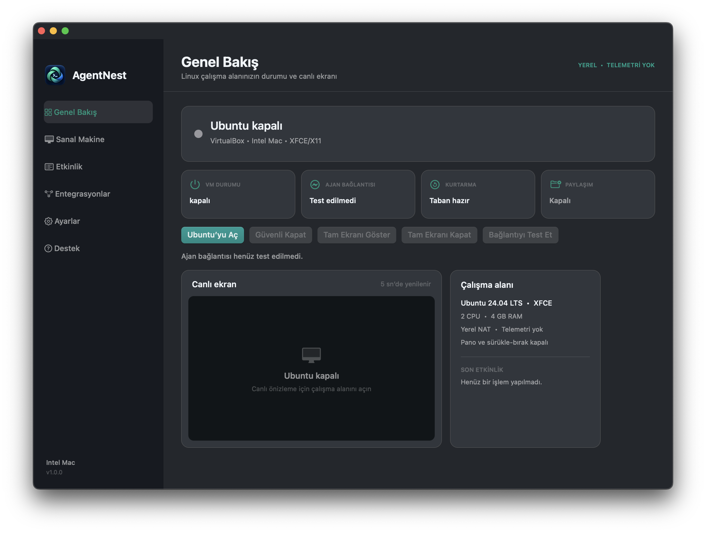
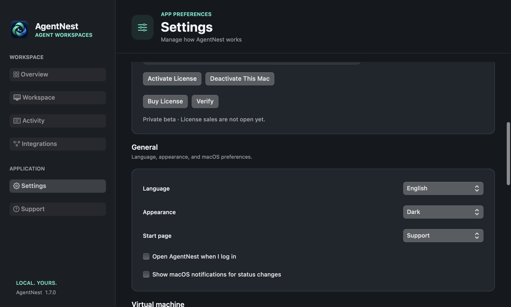

  

<h1 align="center">AgentNest</h1>

<strong>A separate, local Linux computer for your AI coding agent.</strong>

  
  
  
  
  

> AgentNest is currently in private beta.

## Product overview

AgentNest is a native macOS control center that gives MCP-compatible coding agents their own Ubuntu 24.04 virtual machine. It keeps experimental agent work away from the host system while still providing the terminal, screen, keyboard, mouse, files, and recovery tools needed for real development tasks.

## Core capabilities

| Capability | What it provides |
| --- | --- |
| Dedicated Linux workspace | A reproducible Ubuntu environment reserved for the agent instead of unrestricted access to the developer's Mac. |
| Native control center | Start, stop, inspect, configure, and monitor the workspace from a focused AppKit application. |
| MCP computer controls | Terminal execution, screenshots, mouse and keyboard input, file operations, and checkpoint management. |
| Controlled host access | Selected folders can be shared explicitly and mounted read-only by default. |
| Checkpoints and recovery | Known-good VM states make experiments reversible and reduce recovery time. |
| Coding-agent integrations | Designed to connect with MCP-capable tools without changing the developer's primary environment. |
| Local-first operation | The virtual machine, control plane, logs, and settings remain on the Mac. |

## Product tour

| Workspace overview | Settings and access controls |
| --- | --- |
|  |  |

## Security and privacy

- SSH is bound to localhost rather than exposed to the local network.
- Clipboard sharing, drag and drop, USB passthrough, audio, recording, and remote display are disabled by default.
- Host folders require explicit opt-in and can be mounted read-only.
- Sensitive values are redacted from diagnostic logs.
- AgentNest does not include product telemetry.
- Licensing is verified locally with signed Ed25519 data.

## Technology and platform

| Area | Technology |
| --- | --- |
| macOS application | Swift and AppKit |
| Virtualization | VirtualBox 7 with Ubuntu 24.04 LTS |
| Agent interface | Dependency-free Python MCP server over stdio |
| Workspace connection | Localhost-only SSH |
| Distribution | Signed Intel macOS DMG workflow |
| Supported systems | Intel Macs running macOS 13 or later |

## Product status

AgentNest is being developed as a focused developer tool for safer, observable AI-assisted engineering. The application source and release infrastructure are private while the product is in beta; this repository documents the product and its design goals.
