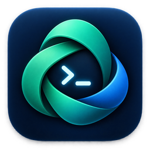

  

# AgentNest

AgentNest gives MCP-capable coding agents a dedicated Ubuntu 24.04 workspace on Intel Macs. A native macOS app manages the virtual machine while agents work with a terminal, screen, and files inside the isolated environment.

- Dedicated Ubuntu workspace
- Native macOS virtual-machine controls
- Terminal, screen, and file access for agents
- Host isolation by default

## Source availability

This repository is a product showcase. The application source code is private.
